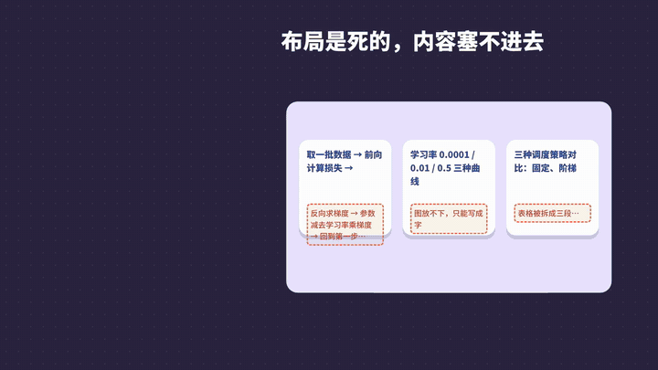
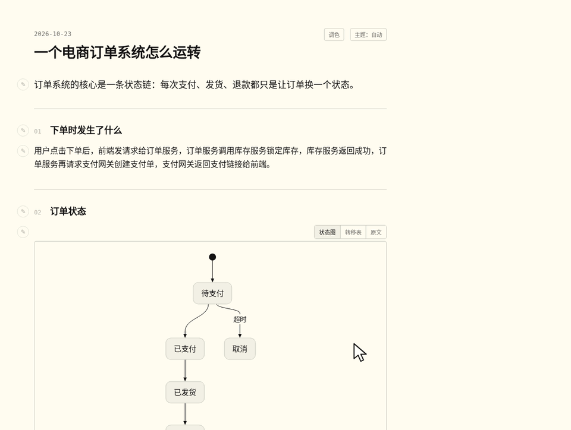

<p align="center"></p>

<h1 align="center">call-pele-answer</h1>
<p align="center"><b>Turn complex answers into pages people actually understand.</b><br><a href="README.md">中文</a></p>

**call-pele-answer is an open-source agent skill for Claude Code, OpenAI Codex CLI, Cursor and OpenCode that turns a long AI answer into a one-file, offline, interactive HTML explainer.** Instead of forcing content into a fixed template, it splits the answer into blocks and picks the best form for each one — prose, table, flowchart, state diagram, timeline, slider, tabs, step player — then composes them into a single page with a built-in palette and annotations.

<p align="center"><a href="https://github.com/dotpopo/call-pele-answer/blob/main/docs/promo.mp4"></a></p>

## Why not a template?

Templates look great, but their layout is fixed, and someone still has to browse and try them one by one. call-pele-answer looks at the content first:

- **Block-level routing.** The Jev router (TypeSafe, System One protocol) scores candidate forms per block in about 200 ms (2 ms on cache hit). No key? A free endpoint or local rules work too. Routing covers all 33 Pele diagram types — mindmap, use case, C4 context, requirement, event modeling, kanban, packet, Wardley map, Cynefin, railroad grammar and more — and leans toward a diagram when a block carries structure.
- **The model writes only Markdown.** The bundled CLI handles layout, colors, diagram coordinates and lint checks.
- **Palette + annotations in the page.** Recolor anything from a whole section down to one paragraph, table cell, diagram node or pie slice — main colour and background separately — leave typed notes, copy them back to your agent with block IDs.
- **Self-improving.** Every run is logged to `runs.jsonl`; `pe stats` gives tuning advice. One 6-block answer went from 2.0 s to 40 ms.
- **Pluggable like Lego.** 9 extension points: form, adapter, router, deriver, theme, palette, annotation, output, rule.



## Install

Node.js 18+, no `npm install`.

```
/plugin marketplace add dotpopo/call-pele-answer
/plugin install call-pele-answer@call-pele-answer
```

Other agents: copy `skills/call-pele-answer/` into your agent's skills folder.

```bash
node skills/call-pele-answer/scripts/pe.mjs answer answer.md -o page.html
```

Optional faster routing: `export TYPESAFE_API_KEY=...` (keys are read from env or `~/.call-pele-answer/config.json`, never written into pages).

MIT © Nadiya Nova · third-party notices in [NOTICE](NOTICE).
