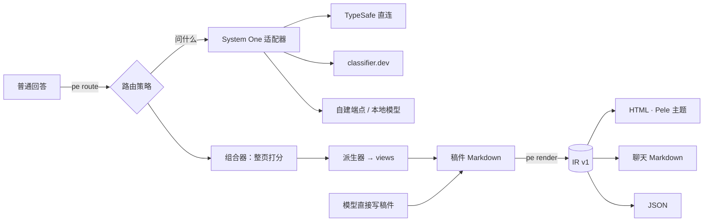

# call-pele-answer

按块路由的解释技能 / 插件。给**每一块内容**挑最合适的形式（文字、表格、图、步骤、滑杆……），再由组合器决定整页怎么搭，输出一页离线、可调色的解释页面。



## 安装

- Claude Code：`/plugin marketplace add <本仓库>`，再 `/plugin install call-pele-answer@call-pele-answer`
- 其他 Agent：把 `skills/call-pele-answer/` 放进 Agent 的 skills 目录。需要 Node.js 18+，无需 `npm install`（Pele 已内置于 `scripts/vendor/`，MIT）。

## 常用命令

```bash
node skills/call-pele-answer/scripts/pe.mjs render draft.md -o page.html
node skills/call-pele-answer/scripts/pe.mjs route answer.md -o draft.md --render page.html
node skills/call-pele-answer/scripts/pe.mjs info
node skills/call-pele-answer/scripts/pe.mjs config set router hybrid
node test/run.mjs        # 离线回归测试
node bench/run.mjs       # 路由基准（会调用远程分类器）
```

## 目录

```
.claude-plugin/          插件清单
skills/call-pele-answer/
  SKILL.md               给 Agent 的说明
  references/            路由细则、文字规则、Pele 美学、扩展 API、设计笔记
  scripts/
    pe.mjs               CLI
    core/                registry（9 个扩展点）· markdown（稿件 → IR）· render · compose（组合器/派生器）· engine
    forms/               mermaid · callout · steps · tabs · slider · views · code
    routers/             catalog · engine（策略）· systemone（适配器：native / shim）
    themes/              默认主题（设计令牌 + CSS）· 调色器
    outputs/             html · markdown · json
    lint/                STE 文字规则 · 形式选择规则
    vendor/pele.mjs      图表渲染引擎（MIT，署名见 NOTICE）
examples/                示例稿件、路由前后对比、示例插件 kpi.mjs
test/  bench/
```

扩展方式见 `skills/call-pele-answer/references/plugins.md`。
