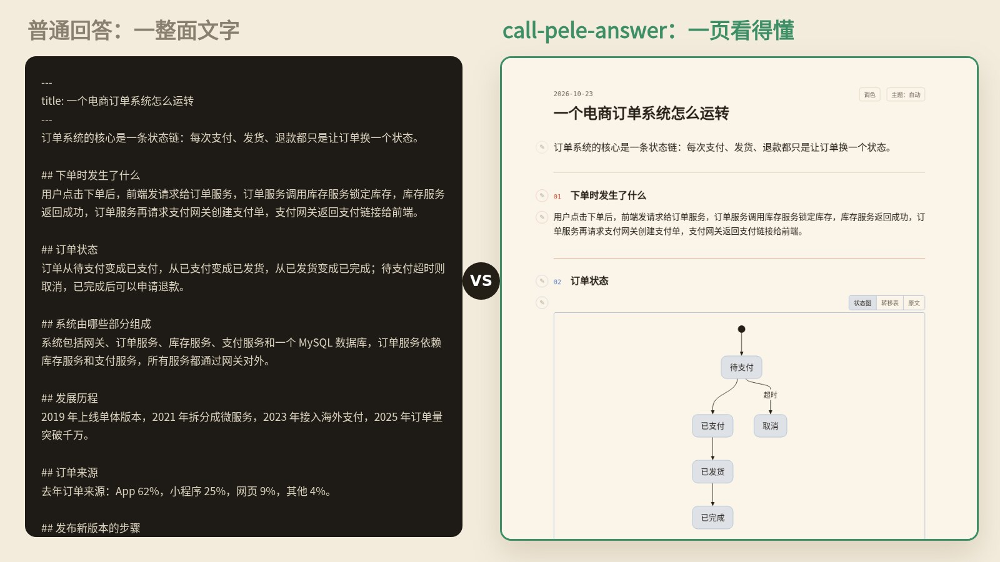
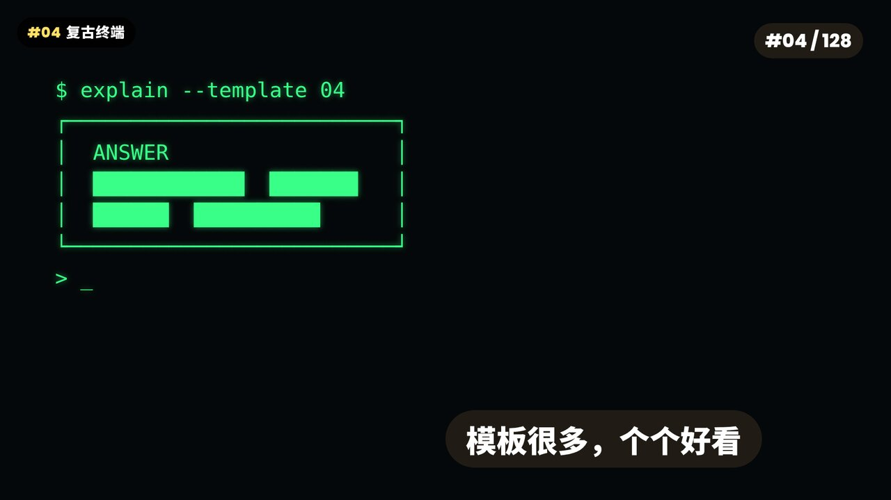
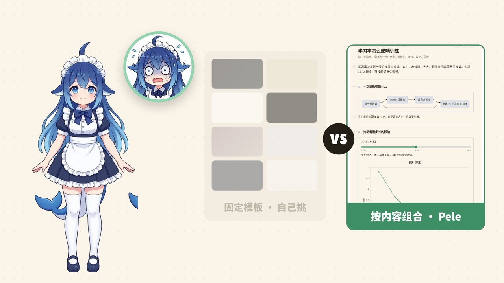
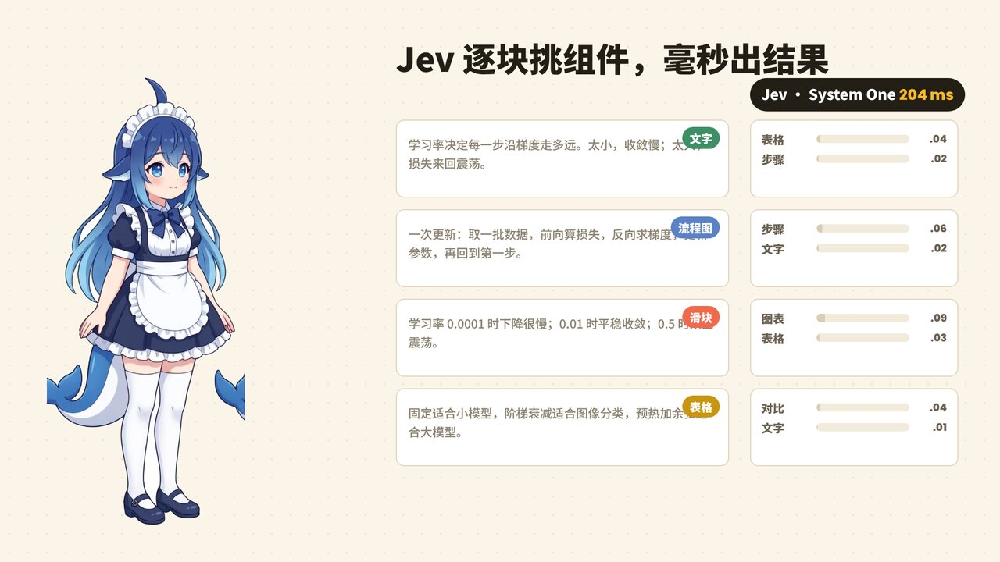
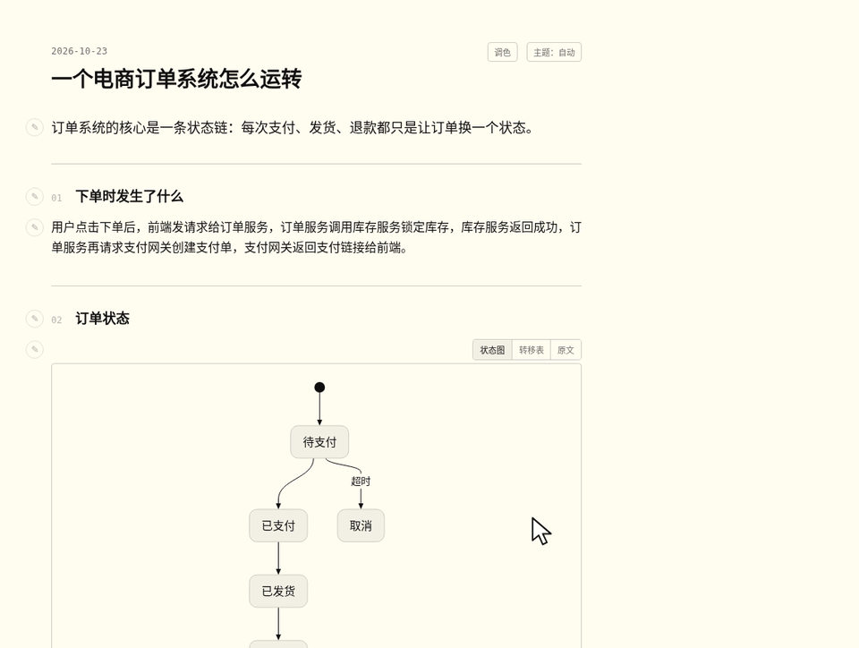
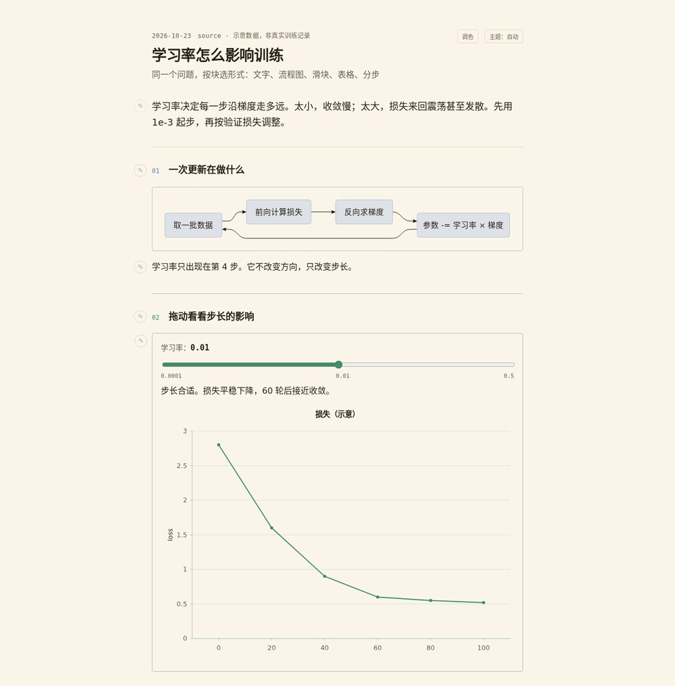
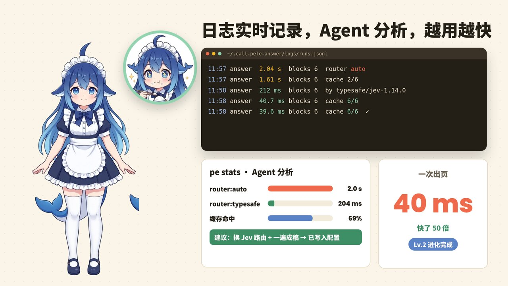

<p align="center">
  
</p>

<h1 align="center">call-pele-answer</h1>

<p align="center">
  <b>把复杂的事，变成看得懂的页面</b><br>
  <sub>An AI agent skill that turns long answers into readable, interactive one-page HTML explainers — block by block, not template by template.</sub>
</p>

<p align="center">
  <b>按块组合&nbsp;&nbsp;|&nbsp;&nbsp;Jev 毫秒选型&nbsp;&nbsp;|&nbsp;&nbsp;调色 + 批注&nbsp;&nbsp;|&nbsp;&nbsp;日志驱动自我进化&nbsp;&nbsp;|&nbsp;&nbsp;单文件离线</b>
</p>

<p align="center">
  <a href="https://github.com/dotpopo/call-pele-answer/stargazers"></a>
  
  
  
  
</p>

<p align="center">
  <a href="#安装">安装</a> · <a href="#效果">效果</a> · <a href="#宣传片">宣传片</a> · <a href="#它和模板有什么不同">为什么不是模板</a> · <a href="#常见问题">常见问题</a> · <a href="README.en.md">English</a>
</p>

---

**call-pele-answer 是一个给 AI 编程助手（Claude Code、Codex CLI、Cursor、OpenCode 等）用的解释技能。** 你像平常一样提问，Agent 把回答写成 Markdown，技能把它**逐块**拆开，给每一块挑最合适的呈现方式——文字、表格、流程图、状态图、时间线、滑块、标签页、分步播放——再组合成**一页离线 HTML**。页面自带调色器和批注，用得越多，它越快。

```
> 讲讲学习率怎么影响训练
> 这个订单系统是怎么运转的？画出来
> Redis 和 Memcached 对比一下，做成一页
```

<p align="center">
  
</p>
<p align="center"><sub>真实页面实录：同一块内容可在「状态图 / 转移表 / 原文」「时间线 / 表格 / 原文」之间切换；打开调色器给内容块换色，切换照样可用。</sub></p>

<details>
<summary>对比：普通文字回答 vs 生成的页面</summary>


</details>

## 宣传片

<p align="center">
  <a href="https://github.com/dotpopo/call-pele-answer/blob/main/docs/promo.mp4">
    
  </a>
</p>
<p align="center"><sub>点击观看 38 秒完整版（有音乐）。主角 Pele 是这个技能的拟人形象。</sub></p>

## 它和模板有什么不同

市面上的「AI 生成好看页面」大多是**模板**：每个都漂亮，但布局是死的。

<table>
<tr>
<td width="50%"></td>
<td width="50%"></td>
</tr>
<tr>
<td><b>模板</b>：布局固定，流程图塞进三列卡片、表格被拆成三段；还得自己一个个翻、一个个试。</td>
<td><b>call-pele-answer</b>：先看内容长什么样，再决定每一块用什么形式，最后整页一起排。</td>
</tr>
</table>

| | 固定模板 | call-pele-answer |
| :--- | :--- | :--- |
| 选形式 | 人挑模板，内容去迁就布局 | 按每一块的信息形状自动选 |
| 一页里的形式 | 一种布局到底 | 文字、表格、图、滑块、多视图混排 |
| 模型要写什么 | 整页 HTML / CSS / SVG | 只写 Markdown 稿件 |
| 改颜色、提意见 | 改代码 | 页面里点调色器、写批注，一键复制给 Agent |
| 用久了 | 不变 | 日志记录每次耗时，Agent 分析后自动调优 |

## 效果

### 1. Jev 逐块挑组件，毫秒出结果



回答按 `##` 拆块后，路由器（默认 TypeSafe **Jev** 模型，System One 协议）给每块的候选形式打分：讲因果的用文字，讲步骤的用流程图，讲参数影响的用滑块，讲对比的用表格。一次路由约 200 ms，命中缓存时 2 ms；没有 key 也能用免费通道或纯本地规则。

### 2. 组合成一页：可调色、可批注



- **调色器**：墨纸 / 暖纸 / 蓝图三套预设 + 8 个色板。点得越准选得越细：整节、组件、标题、段落、表格的一行或一格、图里的一个节点或一块扇区都能单独配色；每个目标分「主色 / 背景」，用「上一层」扩大范围。结果一行 `palette:` 写回稿件。
- **批注**：疑问 / 建议 / 认可 / 顾虑四类，带块编号（如 `s2.1`）一键复制成 Markdown 发回给 Agent 修改。
- **单文件离线**：图在本地渲染成 SVG，不依赖 CDN，发给谁都能直接打开。

<p align="center"></p>

### 3. 日志实时记录，Agent 分析，越用越快



每次运行都写入 `runs.jsonl`（各阶段耗时、缓存命中、路由器）。`pe stats` 汇总后给出建议，Agent 照着改配置：实测同一份 6 块回答，出页从 **2.0 s 降到 40 ms**。

## 安装

需要 [Node.js](https://nodejs.org/) 18+，无需 `npm install`，CLI 已打包在技能里。

**Claude Code**

```
/plugin marketplace add dotpopo/call-pele-answer
/plugin install call-pele-answer@call-pele-answer
```

**Codex CLI / Cursor / OpenCode / 其他 Agent**：把 `skills/call-pele-answer/` 复制进 Agent 的 skills 目录即可。

**可选：更快的路由**（不配也能用）

```bash
export TYPESAFE_API_KEY=...      # Jev 路由，约 0.2 s
# 或 export CLASSIFIER_API_KEY=...
```

Key 只从环境变量或 `~/.call-pele-answer/config.json` 读取，不会写进生成的页面。

## 常用命令

```bash
PE=skills/call-pele-answer/scripts/pe.mjs
node $PE answer 回答.md -o 页面.html      # 一遍成页（推荐）
node $PE route  回答.md -o 稿件.md        # 只路由，看每块选了什么
node $PE render 稿件.md -o 页面.html      # 渲染手写稿件
node $PE stats                            # 日志分析与调优建议
node test/run.mjs                         # 离线回归测试（44 项）
```

## 可以像乐高一样扩展

9 个扩展点：形式（form）、路由适配器（adapter）、路由策略（router）、派生器（deriver）、主题（theme）、色板（palette）、批注类型（annotation）、输出（output）、检查规则（rule）。写一个 `.mjs` 插件、在 `.pele-explain.json` 里登记即可，示例见 [`examples/plugins/kpi.mjs`](examples/plugins/kpi.mjs) 和 [扩展文档](skills/call-pele-answer/references/plugins.md)。

## 常见问题

**call-pele-answer 是什么？**
一个开源的 AI Agent 技能（Agent Skill / Claude Code 插件），把 AI 的长回答变成按内容组合的单页 HTML 解释页面。

**和让模型直接写 HTML 有什么区别？**
模型只写 Markdown，排版、配色、图的坐标都由 CLI 完成：输出更少、更快、更稳定，且每一块都按内容选形式，而不是套一个固定模板。

**支持哪些 Agent？**
Claude Code（插件市场安装）、OpenAI Codex CLI、Cursor、OpenCode，以及任何能读 `SKILL.md` 技能目录的 Agent。

**支持哪些图表？**
内置渲染 30+ 种 Mermaid 图（流程图、时序图、状态图等），另有滑块、标签页、分步播放、多视图切换、表格和提示框。

**需要联网或付费吗？**
不需要。没有 key 时走免费通道或本地规则；生成的页面完全离线。

**能用中文吗？**
能。页面和稿件跟随用户的语言，中英文都可以。

## 许可

MIT © Nadiya Nova。第三方组件与署名见 [NOTICE](NOTICE)。

<sub>关键词：AI 解释页面 · Agent Skill · Claude Code 插件 · Codex 技能 · Markdown 转 HTML · Mermaid 渲染 · 交互式讲解 · 可视化回答 · explainer · answer to HTML · interactive explanation</sub>
