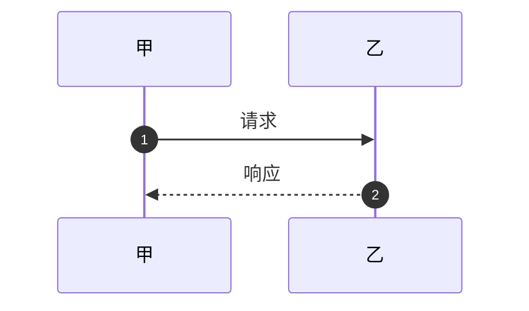
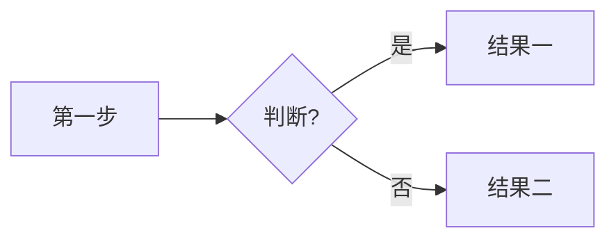

订单系统的核心是一条状态链：每次支付、发货、退款都只是让订单换一个状态。

## 下单时发生了什么
<!-- route: sequence/sequenceDiagram 0.99 -->
用户点击下单后，前端发请求给订单服务，订单服务调用库存服务锁定库存，库存服务返回成功，订单服务再请求支付网关创建支付单，支付网关返回支付链接给前端。

<!-- TODO 按下面的 Pele 骨架改写这块，删掉正文里重复的描述

-->

## 订单状态
<!-- route: state/stateDiagram 1.00 -->
```views
=== 状态图
~~~mermaid
stateDiagram-v2
  [*] --> 待支付
  待支付 --> 已支付
  已支付 --> 已发货
  已发货 --> 已完成
  待支付 --> 取消 : 超时
~~~
=== 转移表
| 从 | 到 | 触发 |
|---|---|---|
| 待支付 | 已支付 | — |
| 已支付 | 已发货 | — |
| 已发货 | 已完成 | — |
| 待支付 | 取消 | 超时 |
=== 原文
订单从待支付变成已支付，从已支付变成已发货，从已发货变成已完成；待支付超时则取消，已完成后可以申请退款。
```

## 系统由哪些部分组成
<!-- route: structure/architecture 1.00 -->
系统包括网关、订单服务、库存服务、支付服务和一个 MySQL 数据库，订单服务依赖库存服务和支付服务，所有服务都通过网关对外。

<!-- TODO 按下面的 Pele 骨架改写这块，删掉正文里重复的描述

-->

## 发展历程
<!-- route: timeline/timeline 1.00 -->
```views
=== 时间线
~~~mermaid
timeline
  2019 : 上线单体版本
  2021 : 拆分成微服务
  2023 : 接入海外支付
  2025 : 订单量突破千万
~~~
=== 表格
| 年份 | 事件 |
|---|---|
| 2019 | 上线单体版本 |
| 2021 | 拆分成微服务 |
| 2023 | 接入海外支付 |
| 2025 | 订单量突破千万 |
=== 原文
2019 年上线单体版本，2021 年拆分成微服务，2023 年接入海外支付，2025 年订单量突破千万。
```

## 订单来源
<!-- route: chart/pie 1.00 -->
```views
=== 饼图
~~~mermaid
pie title 占比（来源：待补）
  "App" : 62
  "小程序" : 25
  "网页" : 9
  "其他" : 4
~~~
=== 表格
| 项 | 数值 |
|---|---|
| App | 62% |
| 小程序 | 25% |
| 网页 | 9% |
| 其他 | 4% |
=== 原文
去年订单来源：App 62%，小程序 25%，网页 9%，其他 4%。
```

## 发布新版本的步骤
<!-- route: steps/flowchart 0.99 -->
先在预发环境跑完回归测试，再灰度 5% 流量，观察半小时，没有报错就全量，最后关闭旧版本。

<!-- TODO 按下面的 Pele 骨架改写这块，删掉正文里重复的描述

-->

## 两种库存扣减方案
<!-- route: table 0.99 -->
下单扣库存和支付扣库存相比：前者防超卖但容易被恶意占库存，后者体验好但高并发时可能超卖，在一致性、实现难度、用户体验三个方面各有取舍。

<!-- TODO 改成表格：行 = 选项，列 = 维度，状态列写 ok/no/warn -->
